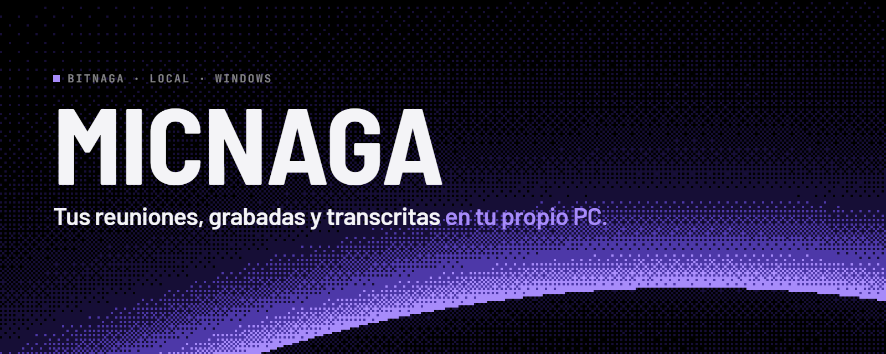
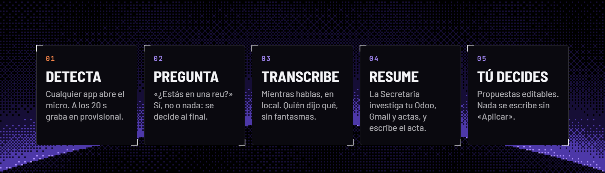
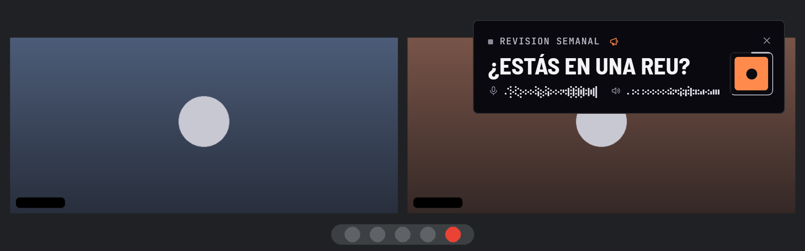
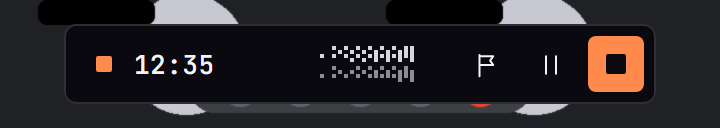
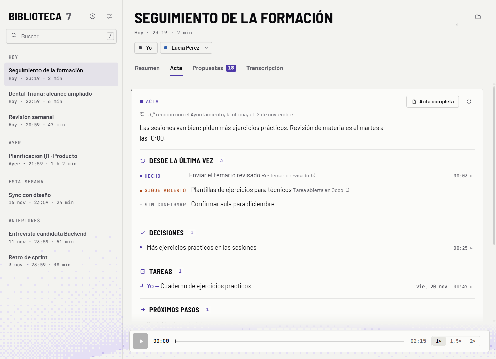
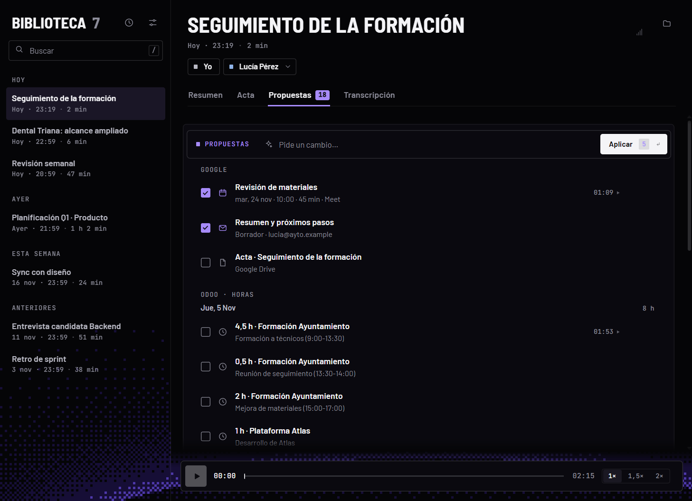
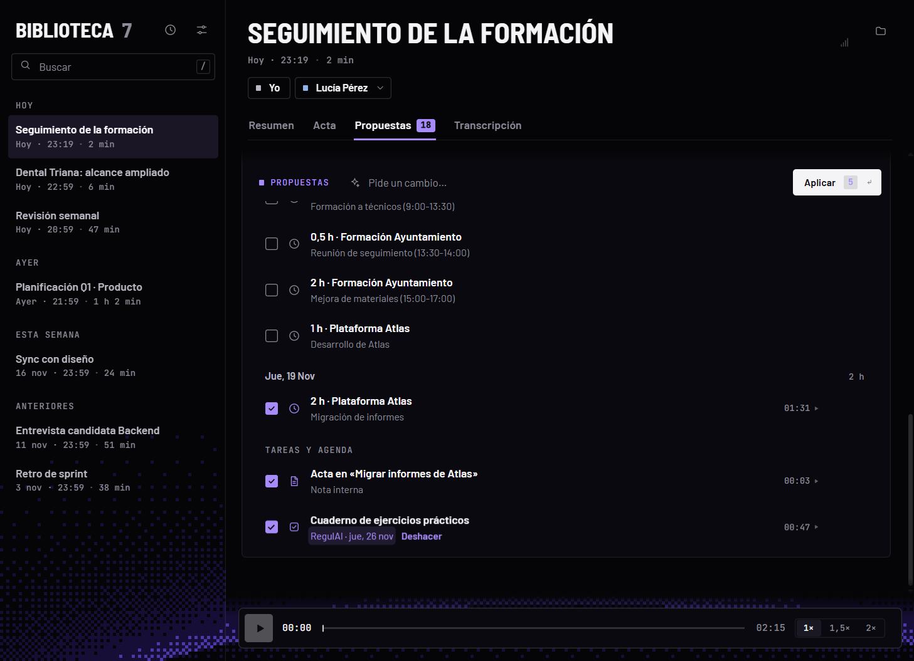
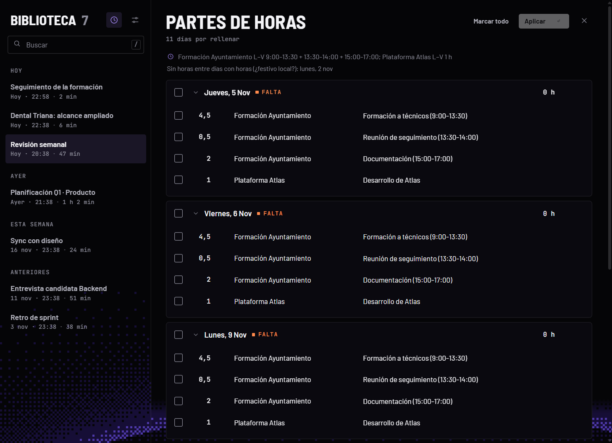
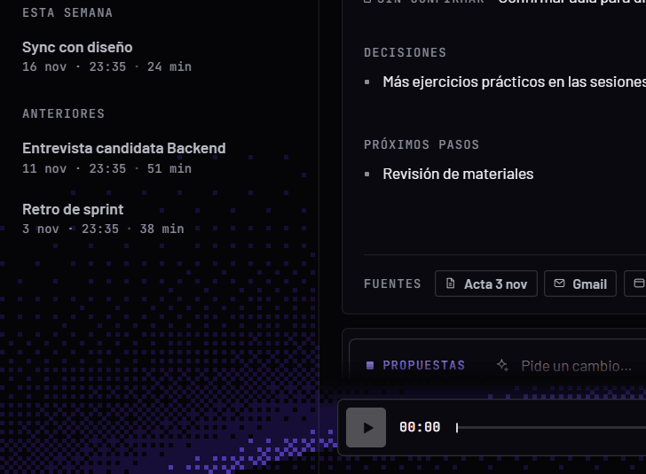

<p align="center">
  
</p>

<p align="center">
  <a href="https://github.com/JaviCKP/micnaga/releases/latest/download/Micnaga-Setup-0.1.0.exe"><b>Descargar para Windows</b></a>
  &nbsp;·&nbsp; <a href="docs/ONBOARDING.md">Guía de puesta en marcha</a>
  &nbsp;·&nbsp; <a href="#cómo-funciona">Cómo funciona</a>
  &nbsp;·&nbsp; <a href="#privacidad">Privacidad</a>
</p>

<br>

Micnaga se da cuenta de que estás en una reunión (Meet, Teams, Zoom o cualquier app que use el micro), la
graba, la transcribe **en tu propio ordenador** y te deja el acta lista al colgar. Si quieres, una Secretaria
con IA lee tu Odoo, tu Gmail y tus actas anteriores y te propone las tareas, la siguiente reunión y el correo
de seguimiento. **Nada se escribe en ningún sitio hasta que pulsas «Aplicar».**

<p align="center"></p>

## Instalar

1. Descarga **[Micnaga-Setup-0.1.0.exe](https://github.com/JaviCKP/micnaga/releases/latest)** (70 MB) y ábrelo. Se instala con un clic y arranca con Windows.
2. La primera vez descarga los modelos de voz (~700 MB) y comprueba tu micro y tu audio.
3. Ya está. Vive en la bandeja del sistema y no tienes que abrirlo para que funcione.

Requisitos: Windows 10 22H2 u 11, de 64 bits. Para la Secretaria, tener [Claude Code](https://claude.com/claude-code) con tu sesión iniciada. Todos los pasos (Odoo, Google y cómo dejarlo siempre encendido) están en **[docs/ONBOARDING.md](docs/ONBOARDING.md)**.

## Cómo funciona

### 1 · Te pregunta, no te espía



Cuando una app lleva 20 s usando el micro, Micnaga empieza a grabar **en provisional** y lo dice con una
píldora siempre visible. A los 20 s te pregunta *«¿Estás en una reu?»*:

- **Sí:** se guarda y se transcribe.
- **No:** se para y se aparta en *Descartadas*. Durante 7 días puedes recuperarla.
- **No contestas:** sigue grabando y te pregunta al final.

Cuando sueltas el micro sale *«Reunión terminada»*, y la grabación se recorta justo en ese momento.

<p align="center"></p>

### 2 · Transcribe mientras hablas

Graba **tu micro y el audio del sistema en pistas separadas**, así que sabe qué dijiste tú y qué dijeron los demás.
Va transcribiendo por trozos durante la reunión, en local y con prioridad baja. Al colgar solo le queda el final.
Separa a los hablantes sin «fantasmas» y quita el eco solo cuando hay eco (con cascos se lo salta). Para una
reunión importante, **«Mejorar transcripción»** la vuelve a escuchar entera con Whisper large-v3, y la versión
anterior se conserva.

### 3 · Primero lo esencial


Cada reunión se abre en **Resumen**: dos o tres frases y lo que te toca (**tu tarea**, **lo siguiente**, **lo
decidido**, lo que quedó **pendiente** de la vez anterior), más un solo botón para revisar las propuestas. El
**Acta** completa, las **Propuestas** y la **Transcripción** están a una pestaña. *Acta completa* genera un
documento formal, de 3 a 5 páginas, con cada frase enlazada a su momento del audio.

<table>
  <tr>
    <td width="50%"></td>
    <td width="50%"></td>
  </tr>
  <tr>
    <td align="center"><sub>Acta: desde la última vez, decisiones, tareas, próximos pasos, contrastes</sub></td>
    <td align="center"><sub>Propuestas: Google Calendar con Meet, borrador de Gmail, Odoo</sub></td>
  </tr>
</table>

### 4 · Una Secretaria que investiga antes de escribir

Antes de redactar, la Secretaria (Claude, vía tu propio `claude -p`):

- **lee tus actas anteriores** con esas personas;
- busca en **Gmail** y **Drive**;
- mira el **calendario**;
- consulta tu **Odoo**: contactos, proyectos, tareas abiertas y oportunidades.

Con eso:

- Marca lo que quedó pendiente de la última vez como *hecho*, *abierto* o *sin confirmar*, con la prueba.
- Avisa de los **contrastes**: *«se dijo 4.500 €, el correo dice 4.800 €»*.
- No duplica tareas que ya existen.
- Nunca inventa: todo lo que no sale de la reunión lleva su fuente.

Antes del acta, **Haiku repasa la transcripción** y corrige la puntuación, las tildes, las palabras mal oídas
y las frases partidas. Ves el original con un clic.

### 5 · Tú decides, y puedes corregirle



Cada propuesta se puede editar campo a campo o **corregir con un mensaje** (*«mejor el jueves y en el proyecto
RegulAI»*), y se rehace en unos segundos. Puede:

- crear tareas, notas internas, actividades, gastos y **partes de horas** en Odoo;
- crear eventos con **Meet** en Google Calendar, sincronizados con Odoo;
- preparar borradores en Gmail y guardar el acta en Drive.

Invitar a gente o enviar un correo nunca viene marcado. Al aplicar, un filtro de Micnaga solo deja pasar
**exactamente** lo que aprobaste.

<p align="center"></p>

### 6 · Aprende de tu empresa

- Con cada conexión a Odoo descubre **qué puede hacer tu usuario** y solo ofrece eso. Una cuenta con CRM ve
  oportunidades y contactos; una sin CRM, no.
- Guarda lo que va aprendiendo (proyectos, convenciones, quién suele estar en las reuniones de cada cliente)
  en una memoria que puedes revisar, deshacer u olvidar en **Ajustes → Lo que ha aprendido**.
- Aprende tu forma de fichar para rellenarte los partes que faltan.

<p align="center"></p>

## Privacidad

- **El audio nunca sale de tu PC.** Grabación, transcripción y separación de hablantes ocurren en local, en CPU.
- **Sin la Secretaria, la única conexión es descargar los modelos**, desde URLs fijadas y verificadas con SHA-256.
  Sin telemetría, analítica ni cuentas.
- **Con la Secretaria activada,** el *texto* de la reunión va a Claude (Anthropic) mediante tu propio `claude -p`,
  y Micnaga habla con tu Odoo y tus conectores de Google. Nada se escribe sin tu «Aplicar».
- **Nunca graba en silencio:** mientras graba, la píldora está siempre en pantalla.

---

## Para desarrolladores

Especificación: [`docs/SPEC.md`](docs/SPEC.md) · Decisiones y desviaciones: [`DECISIONS.md`](DECISIONS.md) ·
Licencias de terceros: [`THIRD_PARTY_LICENSES.md`](THIRD_PARTY_LICENSES.md).

### Privacidad en detalle

* **Local y privado.** El audio nunca sale del equipo. El texto solo sale si activas la **Secretaria**
  (desactivada por defecto), y solo hacia Claude (Anthropic, vía tu `claude -p`) y tu propio Odoo. Sin ella,
  la **única** conexión de red es la descarga de modelos en el primer arranque, desde URLs de Hugging Face
  fijadas y verificadas con SHA-256. Sin telemetría, sin analítica, sin cuentas.
* **Nunca hay grabación silenciosa:** mientras se graba hay siempre una pastilla visible en pantalla.
* **Huellas de voz** (opcionales, desactivadas por defecto): cifradas con DPAPI de Windows (ligadas a tu
  cuenta) y borrables por persona. Son datos biométricos: pide consentimiento antes de guardar la de un
  compañero.
* **Nada se borra sin un «No» tuyo, y un «No» se puede deshacer.** Cuando una app usa el micro se graba en
  provisional y se pregunta. «No» (o «Descartar» al final) para la grabación y la aparta; lo mismo pasa con lo
  que nunca contestaste. Lo apartado va a la carpeta **`_descartadas`** dentro de tu carpeta de reuniones, en
  tu equipo y sin transcribir. Se borra solo a los `storage.discarded_keep_days` días (7 por defecto) y hasta
  entonces puedes recuperarlo o borrarlo ya desde la biblioteca («Descartadas»). Ten en cuenta que ese audio
  existe en disco durante esos días (mínimo 1; «Borrar ya» lo elimina antes).
* La extensión de navegador opcional no usa la red (solo *native messaging* hacia la app local).

### Instalación desde el código fuente

Requisitos: Windows 10 22H2 / 11 de 64 bits, Python 3.11 y [uv](https://docs.astral.sh/uv/).

```powershell
uv venv --python 3.11 .venv
uv pip install --python .venv\Scripts\python.exe -e ".[asr,diar,aec,ui,dev]"
```

Extras (`pyproject.toml`):

| Extra | Qué trae |
| --- | --- |
| *(núcleo)* | captura, vigilante, almacén SQLite, VAD (Silero en ONNX), utilidades del pipeline |
| `asr` | Parakeet (`onnx-asr`) y Whisper (`faster-whisper`); incluye `sherpa-onnx`, hoy sin uso |
| `diar` | diarización con `diarize`. **Arrastra torch (~1,3 GB).** Sin este extra todo lo remoto es `S1` |
| `aec` | cancelación de eco: Speex (`pyaec`, ganador) y WebRTC (`aec-audio-processing`) |
| `ui` | `pywebview` (WebView2), `pystray`, `windows-toasts`, `Pillow` |
| `bench` / `dev` | métricas WER/DER; herramientas de desarrollo (ruff, mypy, pytest, PyInstaller) |
| `pyannote` | alternativa de diarización (no instalada por defecto; también torch) |

### Primer arranque

Los modelos **no van en el instalador**; un asistente de 3 pasos los descarga (con barra de progreso y
verificación SHA-256) y comprueba el micro y el audio del sistema:

| Modelo | Tamaño | |
| --- | --- | --- |
| Parakeet TDT 0.6B v3 (int8, ONNX) | ~670 MB | por defecto |
| Silero VAD (ONNX) | ~2 MB | por defecto |
| WeSpeaker ResNet34-LM (ONNX) | ~25 MB | por defecto (variante con diarización) |
| faster-whisper `small` | ~486 MB | opcional (`processing.asr_engine = "whisper"`) |

Total por defecto ≈ 700 MB. Se guardan en `%APPDATA%\Micnaga\models` (o `MICNAGA_MODELS`).

### Uso

```powershell
.venv\Scripts\python.exe -m micnaga app           # bandeja + vigilante + ventanas (equivale a `micnaga app`)
.venv\Scripts\python.exe -m micnaga record        # grabar micro + sistema a mano (--seconds N, --out DIR, --synthetic, --recover)
.venv\Scripts\python.exe -m micnaga process DIR   # transcribir una sesión grabada en primer plano
.venv\Scripts\python.exe -m micnaga worker        # proceso de trabajo: consume la cola (--once)
.venv\Scripts\python.exe -m micnaga bench         # banco de pruebas (--synthetic, --testset DIR)
.venv\Scripts\python.exe -m micnaga.ui.demo popup # demo de la UI: popup|pill|library|settings|wizard|toast|tray
```

Cada subcomando acepta `--help`. En la versión instalada se usan `micnaga.exe app` (sin consola) y
`micnaga-cli.exe <comando>` (con consola). Atajos globales por defecto: **Ctrl+Alt+M** (marcador) y
**Ctrl+Alt+P** (pausa privada).

### Configuración (`config.toml`)

Se lee de `%APPDATA%\Micnaga\config.toml` (o `MICNAGA_HOME`) y se edita desde **Ajustes**. Valores por
defecto y significado en [`docs/SPEC.md` §10](docs/SPEC.md); las claves añadidas después de la spec
(`detection.generic_apps`, `mic_grace_s`, `popup_after_recording_s`, `exclude_apps`, `[vad]`,
`processing.aec`, `[ui]`, `[privacy]`, `[startup]`...) están en [`DECISIONS.md` §2](DECISIONS.md) y §5.
Las claves desconocidas se ignoran; un tipo incorrecto da un error claro.

### Cómo funciona la detección

El vigilante sondea cada segundo (coste medido: ~0,2 % de un núcleo) y empieza a grabar enseguida; el
procesado solo ocurre si la sesión pasa las **compuertas** al cerrar (≥ 3 min, ≥ 30 s de voz remota, ≥ 6
cambios de turno; una sesión confirmada con «Grabar» solo exige la duración).

* **Vía rápida de Meet** (spec §5): un navegador (`chrome`, `msedge`, `brave`) usa el micro **y** hay una
  pestaña de Meet del mismo navegador, estables durante `confirm_after_s` (5 s) → popup «¿Estás en una
  reu?». La reunión termina cuando una de las dos señales cae 15 s seguidos.
* **Vía genérica** (cualquier app con el micro: Teams, Zoom, Discord...): cuando una app usa el micro 20 s
  seguidos empieza una grabación **provisional** y 20 s después sale el popup. Si no respondes, deciden
  las compuertas. Se puede desactivar (`detection.generic_apps = false`) o excluir apps
  (`detection.exclude_apps`). *Se aparta de la spec §5/§6; ver `DECISIONS.md` §5.*
* **Extensión de navegador (opcional, F4):** señal «en llamada» exacta desde Meet por *native messaging*;
  ver [`extension/README.md`](extension/README.md).

«Ahora no» ignora esa reunión (por su código) hasta que cuelgues.

### Secretaria (capa de IA, opcional)

Al terminar una reunión, `claude -p` (tu sesión de Claude Code; o un token / una clave de API guardados en el
Administrador de credenciales) lee la transcripción —**solo texto**— y deja `acta.json` + `acta.md` (resumen,
decisiones, tareas con fecha, preguntas abiertas, próximos pasos; cada línea con su marca de tiempo) y una lista
corta de **propuestas**: correcciones (quién es cada hablante, nombres mal transcritos) y, con Odoo, vincular la
reunión a su oportunidad, crear el contacto que falta, mover etapa o importe y programar tus actividades. El
modelo solo tiene herramientas de **lectura** (`micnaga tools`, servidor MCP propio); **nada se escribe sin tu
toque** y todo se puede deshacer. Ajustes › Secretaria: activar, probar Claude, conectar Odoo y ver/olvidar lo que
ha aprendido. Diseño: `docs/design/ai_brain.md`; decisiones en `DECISIONS.md` §17.

```powershell
.venv\Scripts\python.exe -m micnaga brain status            # ¿hay sesión de Claude Code?
.venv\Scripts\python.exe -m micnaga brain analyze <carpeta>  # pasada a mano sobre una reunión
```

### Dónde se guardan los datos

| Qué | Dónde | Variable |
| --- | --- | --- |
| Configuración, huellas de voz, logs, modelos, glosario | `%APPDATA%\Micnaga` | `MICNAGA_HOME` |
| Reuniones (audio FLAC, `transcripcion.md/.srt/.json`) + índice `micnaga.db` | `Documentos\Micnaga` | `MICNAGA_STORAGE` |
| Modelos | `<datos>\models` | `MICNAGA_MODELS` |

Cada reunión es una carpeta con dos pistas (`audio_yo.flac`, `audio_remoto.flac`), `capture.json` y la
transcripción. Si algo falla mientras graba, el audio ya escrito se recupera en el siguiente arranque.

### Tests y calidad

```powershell
.venv\Scripts\python.exe -m ruff check .
.venv\Scripts\python.exe -m ruff format --check .
.venv\Scripts\python.exe -m mypy --strict micnaga
.venv\Scripts\python.exe -m pytest -q
```

Los tests fijan `MICNAGA_HOME/STORAGE/MODELS` a carpetas temporales: nunca tocan tus datos. Marcadores y
variables de entorno:

| Variable | Efecto |
| --- | --- |
| `MICNAGA_RUN_MODELS=1` | ejecuta los tests `@pytest.mark.models` (necesitan modelos; con `MICNAGA_MODELS` apunta a los tuyos, por defecto `<repo>\.models`) |
| `MICNAGA_RUN_SLOW=1` | ejecuta los tests `@pytest.mark.slow` (los de modelos también los activan) |
| `MICNAGA_RUN_REALDEVICE=1` | ejecuta los tests con micro y altavoces reales (en tu sesión interactiva) |
| `MICNAGA_RUN_CLAUDE=1` | ejecuta los tests `@pytest.mark.claude`: el `claude -p` real con tu sesión (gasta uso del plan; Odoo siempre falso) |
| `MICNAGA_HOME` / `MICNAGA_STORAGE` / `MICNAGA_MODELS` | carpetas de datos, reuniones y modelos |
| `MICNAGA_TESTSET` | carpeta del set de prueba real para `micnaga bench` (formato en [`docs/testset_format.md`](docs/testset_format.md)) |

### Empaquetado

```powershell
.\scripts\build.ps1                  # PyInstaller onedir + instalador Inno Setup (dist\installer)
.\scripts\build.ps1 -Variant torch   # respaldo de desarrollo (diarize + torch); no se distribuye
```

* **Un solo instalador** `Micnaga-Setup-<version>.exe` (~69 MiB): programa completo sin torch, con diarización ONNX; los modelos (~700 MB) se descargan solos en el primer arranque. La variante `torch` es solo un respaldo de desarrollo.
* Inno Setup 6 es necesario para el instalador (`winget install JRSoftware.InnoSetup`); sin `iscc.exe` solo se genera `dist\micnaga`.
  Instalación **de un clic**, por usuario y sin administrador; acceso directo con `AppUserModelID` para los toasts;
  «Arrancar con Windows» siempre activo (se apaga en Ajustes); al desinstalar se pregunta antes de borrar tus datos.
  Detalles en `packaging/` y `DECISIONS.md` §13 y §16.
* `python scripts\gen_licenses.py --check` bloquea cualquier dependencia GPL/AGPL/desconocida.

### Aviso legal y de uso

Grabar a otras personas y guardar huellas de su voz exige avisarlas y respetar las normas de tu organización
(RGPD). En España grabar una conversación en la que participas es en general lícito, pero difundirla puede
no serlo; las huellas de voz son datos biométricos (categoría especial del RGPD), por eso están
desactivadas por defecto. El popup incluye el recordatorio «Recuerda avisar de que grabas» (desactivable).
Esto es orientativo, no asesoramiento jurídico (spec §13).

### Licencias y atribuciones

Código de Micnaga: [MIT](LICENSE). Dependencias: [`THIRD_PARTY_LICENSES.md`](THIRD_PARTY_LICENSES.md)
(incluye el resumen de obligaciones LGPL de `soxr`, `pystray` y `libsndfile`).

Modelos (se descargan en el primer arranque; no se redistribuyen con el código). **La atribución es
obligatoria** (CC-BY-4.0) y se muestra también en «Acerca de»:

* **NVIDIA Parakeet TDT 0.6B v3**: © NVIDIA, licencia **CC-BY-4.0**
  (`nvidia/parakeet-tdt-0.6b-v3`; conversión ONNX int8 de `istupakov/parakeet-tdt-0.6b-v3-onnx`).
* **WeSpeaker ResNet34-LM (VoxCeleb)**: WeSpeaker, licencia **CC-BY-4.0** según su ficha de Hugging Face
  (`Wespeaker/wespeaker-voxceleb-resnet34-LM`; el código de WeSpeaker es Apache-2.0).
* **pyannote speaker-diarization community-1** (alternativa opcional, no instalada por defecto):
  pyannote.audio / pyannoteAI, licencia **CC-BY-4.0**.
* Silero VAD (MIT), faster-whisper small de Systran y los pesos de OpenAI Whisper (MIT).

Cancelación de eco: `pyaec` (MIT) sobre SpeexDSP (BSD-3) y WebRTC Audio Processing (BSD-3).
