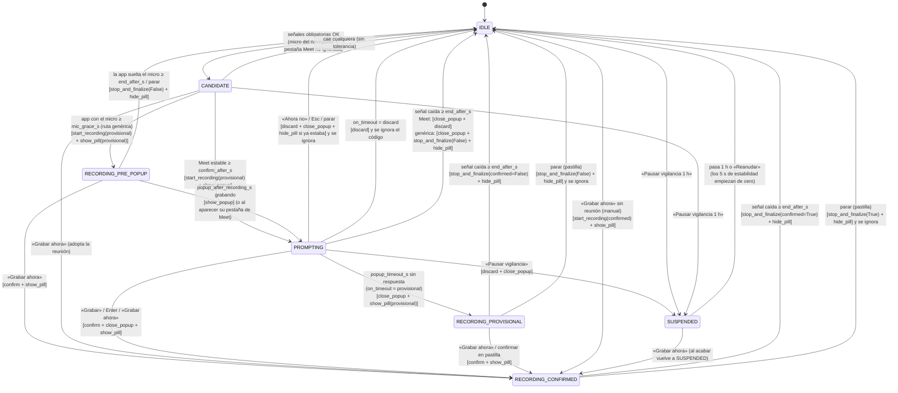
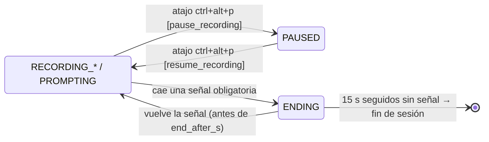

# Máquina de estados del vigilante (spec §5–§6)

> **Derivada, no copiada.** La spec menciona un diagrama de «8 estados, 1 decisión» que no está
> incluido en el documento; esta máquina se ha derivado de las reglas de §5 y de la tabla de
> comportamiento de §6. Implementación: `micnaga/watcher/machine.py` (pura, sin hilos ni reloj
> propio; `step(evento, now) -> list[Acción]`). Pruebas: `tests/watcher/test_machine.py`.

## Estados

Hay siete **fases base** y dos **solapamientos**. `WatcherStateMachine.state` devuelve el estado
observable (para el icono de bandeja y el diagnóstico); `.phase` devuelve la fase base.

| Estado | Qué significa | Tray |
| --- | --- | --- |
| `IDLE` | Vigilando. Sin reunión elegible. | gris |
| `CANDIDATE` | Aún no se graba. O bien Meet (micro + pestaña) lleva `< confirm_after_s` (5 s) estable, o bien alguna app lleva `< mic_grace_s` (20 s) con el micro de forma continua. | gris |
| `RECORDING_PRE_POPUP` | **Ruta genérica**: grabación provisional en marcha y pastilla visible, popup aún no. | rojo |
| `PROMPTING` | Popup visible **y** grabación provisional ya en marcha. | rojo |
| `RECORDING_CONFIRMED` | El usuario dijo «Grabar» (o «Grabar ahora»). Solo exigirá la compuerta 1. | rojo |
| `RECORDING_PROVISIONAL` | El popup caducó sin respuesta (`on_timeout = provisional`). Las compuertas deciden. | rojo |
| `SUSPENDED` | «Pausar vigilancia 1 h». No se evalúan señales. | gris |
| `PAUSED` *(solapamiento)* | Pausa privada activa sobre `PROMPTING` / `RECORDING_*`. | ámbar |
| `ENDING` *(solapamiento)* | Una señal obligatoria cayó; cuenta atrás de `end_after_s` (15 s) sobre `PROMPTING` / `RECORDING_*`. | rojo |
| `IGNORED` *(derivado)* | Fase `IDLE` con algún código ignorado por «Ahora no» hasta colgar. | gris |

`PAUSED` tiene prioridad sobre `ENDING`. «Ignorado» no es una fase: es un diccionario
`código → desde cuándo no se ve`, porque varias reuniones pueden estar ignoradas a la vez y
conviven con un `CANDIDATE` de otra sala.

## Dos rutas de detección

1. **Ruta genérica** (`detection.generic_apps = true`, por defecto). *Cualquier* app que use el
   micro —apps de escritorio (`ConsentStore\microphone\NonPackaged\*`) y apps empaquetadas
   (`ConsentStore\microphone\<PackageFamilyName>`: Teams nuevo, WhatsApp, Zoom de la Store...)—
   dispara la detección:
   * uso **continuo** del micro durante `mic_grace_s` (20 s) → `start_recording(provisional=True)` +
     `show_pill(provisional=True)`, **sin popup**;
   * `popup_after_recording_s` (20 s) después de empezar a grabar (la cuenta se congela en pausa
     privada y con la señal caída) → popup «¿Estás en una reu?» con el nombre amigable de la app;
   * «Grabar» → confirmada; «Ahora no» → se descarta todo, se oculta la pastilla y se ignora esa
     sesión de micro de la app hasta que suelte el micro 15 s; sin respuesta en `popup_timeout_s`
     → sigue provisional (o se descarta si `on_timeout = discard`) y deciden las compuertas.
   * Fin: la app suelta el micro `end_after_s` (15 s). Si el popup seguía **sin responder**, la
     sesión genérica se **finaliza como provisional** (compuertas) y no se descarta: para entonces
     ya hay >= 40 s de llamada grabada.
   * Exclusiones: el propio Micnaga (el intérprete de Python que lo ejecuta, sus variantes
     `pythonw.exe` y `micnaga.exe`) y `detection.exclude_apps` (basename del exe, ruta completa,
     `PackageFamilyName` o su nombre sin sufijo). Los navegadores excluidos siguen en la ruta Meet.
   * `MeetingInfo` genérico: `title` = nombre amigable (tabla pequeña: Teams, WhatsApp, Zoom,
     Discord, Slack, Skype, Webex, «navegador»; si no, el nombre del exe), `code = None`,
     `generic_app = "app:<exe o paquete>"` (clave de ignorado), `browser` solo si es un navegador.
2. **Ruta rápida de Meet** (sin cambios): el navegador con el micro **y** su pestaña de Meet
   estables `confirm_after_s` (5 s) → `start_recording(provisional=True)` + `show_popup` a la vez.
   Si hay una sesión genérica del *mismo navegador* en marcha y aparece su pestaña de Meet, se
   **mejora** a la ruta Meet sin reiniciar la grabación: adopta título/código/monitor y, si el popup
   aún no había salido, lo muestra ya (si ya salió, no se repite). Desde ese momento vive de la
   pestaña de Meet.

## Diagrama

Solapamientos (no son transiciones de fase; se activan sobre `PROMPTING`, `RECORDING_*`):

### La decisión

La única decisión de la máquina es **¿qué hacer al cerrar?**, y depende solo de la fase en que
estaba la sesión cuando acabó:

| Fase al acabar | Acciones | Quién decide después |
| --- | --- | --- |
| `PROMPTING` (ruta Meet) | `close_popup(meeting_ended)`, `discard_recording` | nadie: se descarta todo |
| `PROMPTING` (origen genérico) | `close_popup(meeting_ended)`, `stop_and_finalize(confirmed=False)`, `hide_pill` | las compuertas (ya hay >= 40 s grabados) |
| `RECORDING_PRE_POPUP` | `stop_and_finalize(confirmed=False)`, `hide_pill` | las compuertas |
| `RECORDING_PROVISIONAL` | `stop_and_finalize(confirmed=False)`, `hide_pill` | las tres compuertas (etapa 1 del pipeline) |
| `RECORDING_CONFIRMED` | `stop_and_finalize(confirmed=True)`, `hide_pill` | solo la compuerta de duración |

El vigilante **no evalúa compuertas**: la decisión sobre el audio la toma la etapa 1 del
pipeline (`micnaga.gates`). Pasa `confirmed` y el `MeetingInfo` definitivo al controlador.

## Reglas y decisiones (cubren lo no escrito en la spec)

* **Señales obligatorias «a la vez»**: el micro lo usa el *mismo* navegador que tiene la pestaña de
  Meet (un Meet en Edge con el micro en Chrome no cuenta).
* **Estable 5 s** = `now - primer_tick_con_ambas >= confirm_after_s`; cualquier caída en
  `CANDIDATE` reinicia la cuenta (los parpadeos no disparan).
* **Fin**: `now - primer_tick_sin_señal >= end_after_s`, con reinicio si la señal vuelve (un
  parpadeo de 10 s no termina la sesión). Con sondeo a 1 s, 15 s «seguidos» equivalen a 16 ticks.
* **Identidad pegajosa**: la sesión es *de su código*; otra pestaña de Meet no la mantiene viva.
  Si la sesión empezó sin código (título «Meet: Revisión semanal») la identidad es débil: vale
  cualquier Meet sin código, y si aparece uno con código, se adopta (lobby → llamada).
* **Claves de ignorado**: `código` o `nocode:<navegador>` (Meet) y `app:<exe o paquete>` (genérica). Un «Ahora no» sobre un navegador ignora **ambas** (`código` y `app:<navegador>`), para que la ruta genérica no vuelva a disparar con ese mismo uso del micro. Las claves de app envejecen igual: se olvidan cuando la app suelta el micro `end_after_s`; un corte menor no las olvida.
* **Uso continuo**: cualquier corte del micro de una app reinicia su cuenta de `mic_grace_s`. Gana la app con más tiempo continuo; mientras hay sesión, otras apps no abren otra.
* **Tras parar** (`user_stop`) se ignoran también todas las apps que tengan el micro en ese momento.
* **Liveness del micro**: «en uso» exige un proceso vivo cuyo `create_time` sea anterior a `LastUsedTimeStart` (+10 s); así una entrada obsoleta (`Stop = 0` de un cuelgue) no cuenta ni tras reiniciar la app.
* **«Ahora no»** ignora la clave de la reunión (`código`, o `nocode:<navegador>` si no hay código:
  el título no entra en la clave porque los nombres de pestaña de UIA llevan decoraciones
  localizadas y la misma pestana saldría con dos claves) hasta colgar. «Colgar» = esa clave sin señal ≥ `end_after_s` (un parpadeo no la olvida). Un
  código distinto sí vuelve a preguntar, incluso con el ignorado aún abierto.
* **`on_timeout = "discard"`** también ignora la reunión; si no, volvería a preguntar cada 5 s.
* **Cuenta atrás del popup**: acumula tiempo solo mientras *no* haya ratón encima, *no* esté en
  pausa privada y *no* haya una señal caída. Lo último evita que el timeout (15 s) gane siempre al
  fin de reunión (15 s) y haga inalcanzable «la reunión acaba antes de responder».
* **Parar (pastilla/tray)** vale en cualquier estado de grabación. En `PROMPTING` equivale a «Ahora
  no». Tras parar, las reuniones aún vivas se ignoran (si no, preguntaría de nuevo a los 5 s).
* **«Grabar ahora»**: en `PROMPTING` = «Grabar»; en `RECORDING_PROVISIONAL` confirma; en `CANDIDATE`
  o con una reunión visible adopta esa reunión (la termina la señal); sin reunión es una sesión
  **manual** que solo termina el usuario (no hay señales que la cierren) y a la que Meet no
  molesta con popups.
* **Suspender**: en `IDLE/CANDIDATE` → `SUSPENDED` y olvida lo ignorado; en `PROMPTING` descarta el
  popup; **grabando no interrumpe** (rige al terminar la sesión). Al expirar con las señales ya
  activas, los 5 s de estabilidad empiezan de cero.
* **Pausa privada** solo en `PROMPTING` / `RECORDING_*`; fuera, es un no-op. Si la reunión acaba
  en pausa, igualmente se hace `stop_and_finalize` (el controlador cierra con la pausa activa).
* **Títulos**: solo se toman del título de *ventana* (pestaña activa); los `TabItem` de UIA se usan
  únicamente para detectar Meet y su código. Limitación conocida: una sala sin código «ignorada»
  que pasa a tener código (lobby → llamada) cuenta como reunión nueva.
* **Eventos tardíos** (clic en un popup que ya se cerró, hover sin popup) se ignoran.

## Interfaz del controlador

`micnaga/watcher/controller.py::WatcherController` (la implementa la app; todos los parámetros
son *keyword-only*). La máquina emite acciones en este orden; el `Watcher` las despacha fuera del
lock, en orden, tolerando excepciones y reentradas.

| Acción de la máquina | Método del controlador |
| --- | --- |
| `StartRecording` | `start_recording(provisional: bool, meeting: MeetingInfo)` |
| `ShowPopup` | `show_popup(title, code, monitor_hint, timeout_s)` |
| `ClosePopup` | `close_popup(reason: confirmed \| declined \| timeout \| meeting_ended \| suspended)` |
| `ConfirmRecording` | `confirm_recording()` |
| `DiscardRecording` | `discard_recording()` |
| `StopAndFinalize` | `stop_and_finalize(confirmed: bool, meeting: MeetingInfo)` |
| `ShowPill` | `show_pill(provisional: bool, paused: bool)` (en la ruta genérica sale **antes** del popup y es idempotente) |
| `HidePill` | `hide_pill()` |
| `PauseRecording` / `ResumeRecording` | `pause_recording()` / `resume_recording()` |

Entradas hacia el vigilante (hilo-seguras): `Watcher.popup_answer(accept)`, `popup_hover(bool)`,
`record_now()`, `user_stop()`, `toggle_private_pause()`, `set_private_pause(bool)`,
`suspend(duration_s=3600)`, `resume_watching()`.
