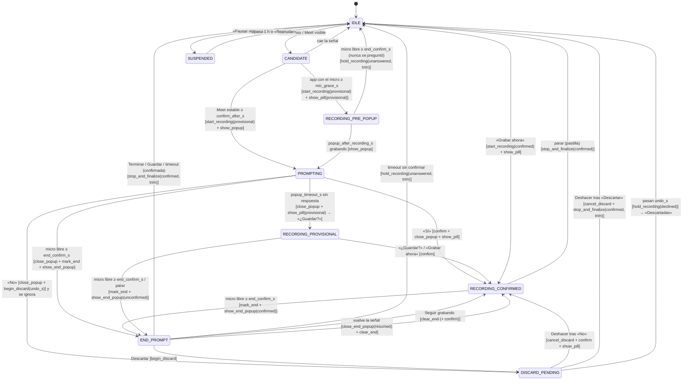

# Máquina de estados del vigilante (spec §5–§6)

> **Derivada, no copiada.** La spec menciona un diagrama de «8 estados, 1 decisión» que no está
> incluido en el documento; esta máquina se ha derivado de las reglas de §5 y de la tabla de
> comportamiento de §6. Implementación: `micnaga/watcher/machine.py` (pura, sin hilos ni reloj
> propio; `step(evento, now) -> list[Acción]`). Pruebas: `tests/watcher/test_machine.py`.

## Estados

> **Flujo revisado a petición del usuario (rama `fix/review-findings`, ver `DECISIONS.md` §18).**
> Resumen «sota, caballo y rey»: *micro en uso → se graba provisional; se pregunta; «Sí» guarda,
> «No» aparta (recuperable 7 días), sin respuesta se decide al final; nada se borra sin un «No».*

Hay nueve **fases base** y dos **solapamientos**. `WatcherStateMachine.state` devuelve el estado
observable (para el icono de bandeja y el diagnóstico); `.phase` devuelve la fase base.

| Estado | Qué significa | Tray |
| --- | --- | --- |
| `IDLE` | Vigilando. Sin reunión elegible. | gris |
| `CANDIDATE` | Aún no se graba. Meet (micro + pestaña) lleva `< confirm_after_s` (5 s) estable, o alguna app lleva `< mic_grace_s` (20 s) con el micro de forma continua. | gris |
| `RECORDING_PRE_POPUP` | Grabación provisional en marcha y pastilla visible; popup aún no (ruta genérica). | rojo |
| `PROMPTING` | Popup «¿Estás en una reu?» visible **y** grabación provisional en marcha. | rojo |
| `RECORDING_CONFIRMED` | «Sí» (o «Grabar ahora»). Solo exige la duración mínima (`gates.min_duration_s`, 30 s). | rojo |
| `RECORDING_PROVISIONAL` | El popup caducó sin respuesta: se sigue grabando; la pastilla ofrece «¿Guardar?». Se decide al final. | rojo |
| `END_PROMPT` | El micro se soltó `end_confirm_s` (2 s): popup de fin. Confirmada: «¿Ha terminado?» (Terminar / Seguir grabando; sin respuesta en `end_popup_timeout_s` = 10 s, termina). Sin confirmar: «¿La guardo?» (Guardar / Descartar; sin respuesta, se aparta). La grabación sigue mientras tanto y luego se recorta al momento en que se soltó el micro. | rojo |
| `DISCARD_PENDING` | Tras un «No»/«Descartar»: la grabación está en pausa (nada se graba) y la pastilla muestra «Descartada · Deshacer» durante `undo_s` (8 s). Sin deshacer → `_descartadas`. | rojo |
| `SUSPENDED` | «Pausar vigilancia 1 h». No se evalúan señales. | gris |
| `PAUSED` *(solapamiento)* | Pausa privada activa sobre `PROMPTING` / `RECORDING_*`. | ámbar |
| `ENDING` *(solapamiento)* | La señal cayó y aún no han pasado `end_confirm_s`. | rojo |
| `IGNORED` *(derivado)* | Fase `IDLE` con alguna reunión/app ignorada por «No» hasta colgar (`end_after_s`). | gris |

## Dos rutas de detección

1. **Ruta genérica** (núcleo; `detection.generic_apps = true`). *Cualquier* app que use el micro
   (escritorio o empaquetada; sin listas blancas) dispara la detección:
   * uso **continuo** del micro durante `mic_grace_s` (20 s) → `start_recording(provisional=True)` +
     `show_pill(provisional=True)`, sin popup;
   * `popup_after_recording_s` (20 s) grabando (la cuenta se congela en pausa privada y con la
     señal caída) → popup «¿Estás en una reu?» con el nombre amigable de la app;
   * Exclusiones: el propio Micnaga (su intérprete/exe y su pid) y `detection.exclude_apps`.
2. **Ruta rápida de Meet**: navegador con el micro **y** su pestaña de Meet estables
   `confirm_after_s` (5 s) → `start_recording(provisional=True)` + `show_popup` a la vez. Una
   sesión genérica del mismo navegador se **mejora** a Meet sin reiniciar la grabación.

## Diagrama

`END_PROMPT` vuelve a la fase previa (no necesariamente `RECORDING_CONFIRMED`) si la señal vuelve
antes de responder; si venía de `PROMPTING`, se vuelve a preguntar.

### La decisión

| Cómo acaba la sesión | Resultado |
| --- | --- |
| «Sí» y luego Terminar / timeout del popup de fin | se transcribe (recortada al soltar el micro) |
| Sin respuesta y «Guardar» al final (o «¿Guardar?» en la pastilla) | se transcribe |
| Sin respuesta al principio **ni** al final | `_descartadas` (`unanswered`), recuperable |
| «No» / «Descartar» sin «Deshacer» | `_descartadas` (`declined`), recuperable |
| Llamada que acaba antes del popup (< ~40 s) | `_descartadas` (`unanswered`), recuperable |
| La app se cierra con una sesión sin confirmar | `_descartadas` (`interrupted`) al cerrar o al arrancar |

`_descartadas` se purga a los `storage.discarded_keep_days` (7) días. «Recuperar» en la
biblioteca devuelve la carpeta, la marca confirmada y la encola. El vigilante no evalúa
compuertas: la etapa 1 del pipeline aparta (no borra) lo que no las pasa.

## Reglas y decisiones (cubren lo no escrito en la spec)

* **Señales obligatorias «a la vez»**: el micro lo usa el *mismo* navegador que tiene la pestaña de
  Meet (un Meet en Edge con el micro en Chrome no cuenta).
* **Estable 5 s** = `now - primer_tick_con_ambas >= confirm_after_s`; cualquier caída en
  `CANDIDATE` reinicia la cuenta (los parpadeos no disparan).
* **Fin**: `now - primer_tick_sin_señal >= end_after_s`, con reinicio si la señal vuelve (un
  parpadeo de 10 s no termina la sesión). Con sondeo a 1 s, 15 s «seguidos» equivalen a 16 ticks.
* **Identidad pegajosa**: la sesión es *de su código*; otra pestaña de Meet no la mantiene viva.
  Si la sesión empezó sin código (título «Meet: Revisión semanal») la identidad es débil: vale
  cualquier Meet sin código, y si aparece uno con código, se adopta (lobby → llamada).
* **Claves de ignorado**: `código` o `nocode:<navegador>` (Meet) y `app:<exe o paquete>` (genérica). Un «Ahora no» sobre un navegador ignora **ambas** (`código` y `app:<navegador>`), para que la ruta genérica no vuelva a disparar con ese mismo uso del micro. Las claves de app envejecen igual: se olvidan cuando la app suelta el micro `end_after_s`; un corte menor no las olvida.
* **Uso continuo**: cualquier corte del micro de una app reinicia su cuenta de `mic_grace_s`. Gana la app con más tiempo continuo; mientras hay sesión, otras apps no abren otra.
* **Tras parar** (`user_stop`) se ignoran también todas las apps que tengan el micro en ese momento.
* **Liveness del micro**: «en uso» exige un proceso vivo cuyo `create_time` sea anterior a `LastUsedTimeStart` (+10 s); así una entrada obsoleta (`Stop = 0` de un cuelgue) no cuenta ni tras reiniciar la app.
* **«No»** (antes «Ahora no») ignora la clave de la reunión (`código`, o `nocode:<navegador>` si no hay código:
  el título no entra en la clave porque los nombres de pestaña de UIA llevan decoraciones
  localizadas y la misma pestana saldría con dos claves) hasta colgar. «Colgar» = esa clave sin señal ≥ `end_after_s` (un parpadeo no la olvida). Un
  código distinto sí vuelve a preguntar, incluso con el ignorado aún abierto.
* **`on_timeout = "discard"`** también ignora la reunión; si no, volvería a preguntar cada 5 s.
* **Cuenta atrás del popup**: acumula tiempo solo mientras *no* haya ratón encima, *no* esté en
  pausa privada y *no* haya una señal caída. Lo último evita que el timeout (15 s) gane siempre al
  fin de reunión (15 s) y haga inalcanzable «la reunión acaba antes de responder».
* **Parar (pastilla/tray)** vale en cualquier estado de grabación. En `PROMPTING` equivale a «Ahora
  no». Tras parar, las reuniones aún vivas se ignoran (si no, preguntaría de nuevo a los 5 s).
* **«Grabar ahora»**: en `PROMPTING` = «Grabar»; en `RECORDING_PROVISIONAL` confirma; en `CANDIDATE`
  o con una reunión visible adopta esa reunión (la termina la señal); sin reunión es una sesión
  **manual** que solo termina el usuario (no hay señales que la cierren) y a la que Meet no
  molesta con popups.
* **Suspender**: en `IDLE/CANDIDATE` → `SUSPENDED` y olvida lo ignorado; en `PROMPTING` descarta el
  popup; **grabando no interrumpe** (rige al terminar la sesión). Al expirar con las señales ya
  activas, los 5 s de estabilidad empiezan de cero.
* **Pausa privada** solo en `PROMPTING` / `RECORDING_*`; fuera, es un no-op. Si la reunión acaba
  en pausa, igualmente se hace `stop_and_finalize` (el controlador cierra con la pausa activa).
* **Títulos**: solo se toman del título de *ventana* (pestaña activa); los `TabItem` de UIA se usan
  únicamente para detectar Meet y su código. Limitación conocida: una sala sin código «ignorada»
  que pasa a tener código (lobby → llamada) cuenta como reunión nueva.
* **Eventos tardíos** (clic en un popup que ya se cerró, hover sin popup) se ignoran.

## Interfaz del controlador

`micnaga/watcher/controller.py::WatcherController` (la implementa la app; todos los parámetros
son *keyword-only*). La máquina emite acciones en este orden; el `Watcher` las despacha fuera del
lock, en orden, tolerando excepciones y reentradas.

| Acción de la máquina | Método del controlador |
| --- | --- |
| `StartRecording` | `start_recording(provisional: bool, meeting: MeetingInfo)` |
| `ShowPopup` | `show_popup(title, code, monitor_hint, timeout_s)` |
| `ClosePopup` | `close_popup(reason: confirmed \| declined \| timeout \| meeting_ended \| suspended)` |
| `ConfirmRecording` | `confirm_recording()` |
| `MarkEnd` / `ClearEnd` | `mark_end()` / `clear_end()` (punto de recorte = cuando se soltó el micro) |
| `ShowEndPopup` | `show_end_popup(confirmed, title, monitor_hint, timeout_s)` |
| `CloseEndPopup` | `close_end_popup(reason: answered \| timeout \| resumed)` |
| `BeginDiscard` / `CancelDiscard` | `begin_discard(undo_s)` (marca en disco síncrona + pausa + chip «Deshacer») / `cancel_discard()` |
| `HoldRecording` | `hold_recording(reason, trim)` → parar, FLAC y mover a `_descartadas` |
| `StopAndFinalize` | `stop_and_finalize(confirmed, meeting, trim)` → parar, FLAC y encolar |
| `ShowPill` | `show_pill(provisional: bool, paused: bool)` |
| `HidePill` | `hide_pill()` |
| `PauseRecording` / `ResumeRecording` | `pause_recording()` / `resume_recording()` |

Entradas hacia el vigilante (hilo-seguras): `Watcher.popup_answer(accept)`, `popup_hover(bool)`,
`end_answer(finish|keep|save|discard)`, `undo()`, `recording_failed()`,
`record_now()`, `user_stop()`, `toggle_private_pause()`, `set_private_pause(bool)`,
`suspend(duration_s=3600)`, `resume_watching()`.
